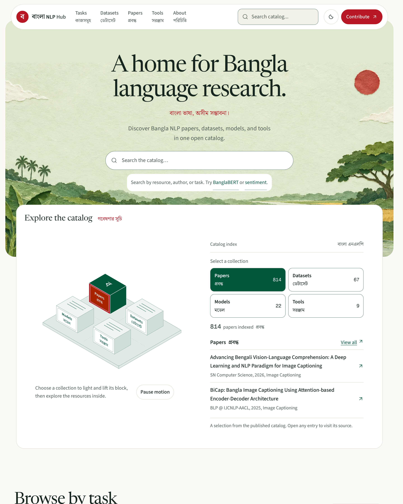

# BanglaNLP Hub

A community-maintained catalog of Bangla / Bengali NLP papers, datasets, models,
tools, and benchmarks.

[Browse the catalog](https://eliteresearchlab.github.io/BanglaNLP-Hub/) · [Hugging Face dataset](https://huggingface.co/datasets/kishormorol/bangla-nlp-catalog) · [DOI](https://doi.org/10.5281/zenodo.22798635)

## Overview

BanglaNLP Hub helps researchers, students, and developers find resources for working
with Bangla. Search the catalog or browse by task to find papers, datasets, models,
and tools. Each entry links to its original source, making it easier to check the
details and choose what to use.



## Run locally

Requires Node.js 22.23.4 or newer. Built with Astro, TypeScript, and vanilla JavaScript.

```sh
npm install
npm run dev
```

The development server runs at `localhost:4321`.

| Command | Action |
| --- | --- |
| `npm run build` | Build to `dist/` |
| `npm run preview` | Preview the production build |
| `npm run validate` | Validate catalog data |
| `npm run check-links` | Check published resource links |

## Contribute

Entries live in YAML under [`data/`](./data). To suggest a resource,
[open an issue with its link](https://github.com/eliteresearchlab/BanglaNLP-Hub/issues/new?template=submit-resource.yml)
or follow [CONTRIBUTING.md](./CONTRIBUTING.md) and submit a PR.

**Only add information you can source.** Leave unknown fields out. Never invent
scores, counts, or BibTeX. Run `npm run validate` before submitting.

See [TODO-data.md](./TODO-data.md) for open data work and
[CONTRIBUTORS.md](./CONTRIBUTORS.md) for resource contributors.

## License

Site code is [MIT](./LICENSE). Linked resources have their own licenses.
Third-party notices and font licenses are retained in [`docs/`](./docs).
